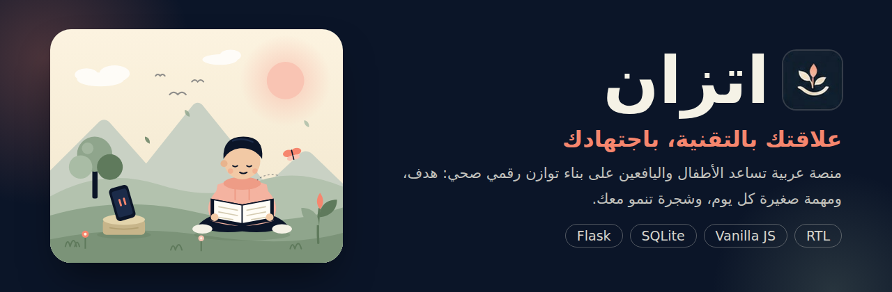
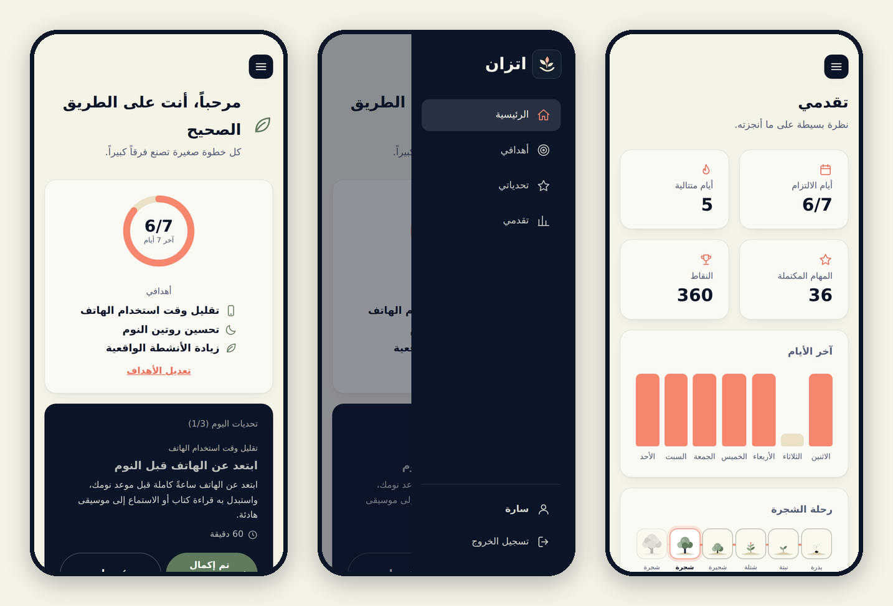

<div align="center">



<br>

[](../../actions/workflows/tests.yml)


### بذرة صغيرة كل يوم… وشجرة تنمو معك 🌱

**[التجربة المباشرة ←](https://shahadalmalkics.pythonanywhere.com/)**

</div>

<div dir="rtl">

**اتزان (Itizan)** منصة ويب عربية تساعد الأطفال واليافعين على تقليل الاستخدام المفرط للشاشات، لا بالحجب ولا بالمراقبة، بل بـ**بدائل واقعية صغيرة**: تختار هدفاً، فتصلك مهمة بسيطة كل يوم تستبدل بها وقتاً أمام الشاشة بشيء حقيقي، وكلما أكملتها نمت **شجرتك الافتراضية** من بذرة إلى شجرة مثمرة.

وُلدت الفكرة استجابةً لتحدّي **«الإدمان الرقمي»** في جائزة نورة الملاحي للابتكار الاجتماعي التقني.

> **English summary:** Itizan is an Arabic-first (RTL) web app that helps children and teens cut excessive screen time through one small offline task per goal each day, not blocking or monitoring. Built with Flask and SQLite, with a tested API, CSRF protection, hashed passwords, and full account deletion. [Live demo](https://shahadalmalkics.pythonanywhere.com/).

<div align="center">



</div>

---

## الفكرة

الاستخدام المفرط أو القهري للتقنية يُفقد صاحبه السيطرة على مدة الاستخدام وتكراره، ويؤثر في دراسته وعلاقاته وصحته. وأدوات كثيرة تكتفي بقياس الوقت أو منعه، والطفل الذي يُطلب منه ترك الشاشة دون بديل جذاب يعود إليها.

لذلك يقوم اتزان على أمرين:

- **بديل واقعي كل يوم:** مهمة صغيرة تُبدأ فوراً، كوجبة بلا شاشة أو نصف ساعة قراءة أو تمدّد قبل النوم.
- **قياس الجودة لا الوقت وحده:** يسجّل المستخدم ساعات استخدامه ويصفه بأنه *هادف* أو *متوازن* أو *تصفّح بلا هدف*.

## المزايا

- من **هدف إلى ثلاثة أهداف**، ومهمة يومية لكل هدف مع إمكانية اختيار المهمة من مكتبة التحديات.
- **شجرة افتراضية** تنمو بعدد أيام الالتزام: بذرة، فنبتة، فشتلة، فشجيرة، فشجرة فتية، فشجرة مثمرة بعد 30 يوماً.
- **لا عقاب:** الشجرة لا تموت، وإن انقطع المستخدم «تستريح» فقط، ولا تفقد أعلى مرحلة بلغتها.
- **صفحة تقدّم:** أيام الالتزام، ونقاط، وساعات الاستخدام أسبوعاً بأسبوع.
- **تصميم هادئ:** لا إشعارات ولا محتوى لا ينتهي، وواجهة RTL كاملة بلغة فصيحة مبسّطة وخط Cairo.

## ما يميّز المشروع تقنياً

| الجانب | التفاصيل |
|---|---|
| **الأمان** | تجزئة كلمات المرور بـ PBKDF2-SHA256، وجلسات `HttpOnly` و`SameSite=Lax`، وحماية CSRF بترويسة مخصصة، وتحديد لمحاولات الدخول، وسياسة محتوى (CSP). |
| **الخصوصية** | اسم واسم مستخدم وكلمة مرور فقط، وكل بيانات المستخدم معزولة وتُحذف مع حسابه (`ON DELETE CASCADE`). |
| **الاختبارات** | اختبارات `unittest` تغطي الحسابات والعزل والأهداف ومنطق الشجرة وترحيل قاعدة قديمة، وتعمل تلقائياً عبر GitHub Actions. |
| **ترحيل البيانات** | ترحيل تلقائي من الصيغة القديمة إلى الحالية دون فقدان ودون تكرار. |
| **الواجهة** | HTML وCSS وJavaScript دون مكتبات خارجية، وقوالب Jinja2، وتصميم متجاوب. |
| **قياس الأثر** | سكربت `impact_report.py` يطبع مؤشرات مجمّعة بلا أي بيانات شخصية. |

## رحلة المستخدم


---

## التشغيل محلياً

المتطلبات: **Python 3.10 فأحدث**.

```bash
git clone https://github.com/ShahadAlmalki-cs/Itizan.git
cd Itizan

python -m venv .venv
source .venv/bin/activate        # ويندوز: .venv\Scripts\Activate.ps1

pip install -r requirements.txt
python app.py
```

ثم افتح **http://127.0.0.1:5000** وأنشئ حساباً. تُنشأ قاعدة البيانات ومفتاح الجلسات تلقائياً عند أول تشغيل، ولا يُرفعان إلى Git.

**الاختبارات:**

```bash
python -m unittest discover tests -v
```

## البنية

```
Itizan/
├── app.py                  الخادم وقاعدة البيانات والـ API ومنطق الشجرة
├── requirements.txt
├── templates/              قوالب الصفحات
├── static/                 css · js · img
├── tests/test_app.py       الاختبارات
├── scripts/impact_report.py   مؤشرات مجمّعة بلا بيانات شخصية
├── docs/images/            صور هذا الملف
└── .github/workflows/      تشغيل الاختبارات تلقائياً
```

الخلفية: Python وFlask. قاعدة البيانات: SQLite (جداول `users` و`goals` و`challenges` و`user_goals` و`daily_picks` و`daily_log` و`usage_log` و`tree_state`).

---

## خارطة الطريق

هذا **نموذج أولي يعمل** ومتاح للتجربة، ولم يُختبر ميدانياً بعد. وما بعده:

- [ ] تجربة ميدانية صغيرة مع يافعين وأسرهم لقياس الأثر
- [ ] استعادة كلمة المرور دون جمع بريد، أو ربط الحساب بولي الأمر
- [ ] عرض خاص بولي الأمر بموافقة المستخدم
- [ ] مراجعة المهام من مختصين تربويين ونفسيين
- [ ] اختبار الإتاحة مع قارئات الشاشة
- [ ] تطبيق ويب تقدّمي (PWA) والانتقال إلى PostgreSQL عند التوسع

**قبل أي نشر واسع:** التشغيل خلف HTTPS مع ضبط `ITIZAN_HTTPS=1` و`ITIZAN_SECRET_KEY`، وإيقاف `debug`، ونقل تحديد المحاولات إلى مخزن مشترك إن تعددت العمليات.

## شفافية

طُوّرت الشيفرة والتوثيق بمساعدة أدوات ذكاء اصطناعي، أما الفكرة والمتطلبات وقرارات التصميم فمن صاحبة المشروع. **التطبيق نفسه لا يستخدم أي ذكاء اصطناعي ولا يتتبع المستخدم خفية.**

##
</div>

</div>
