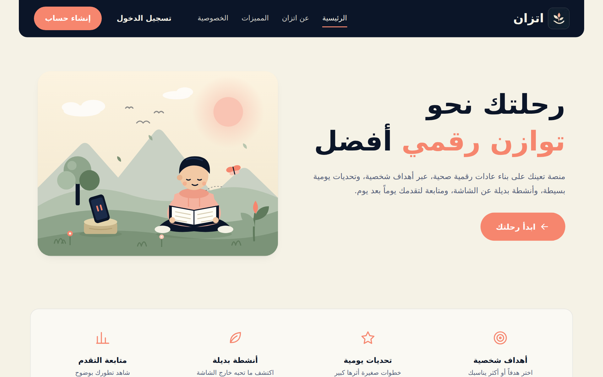
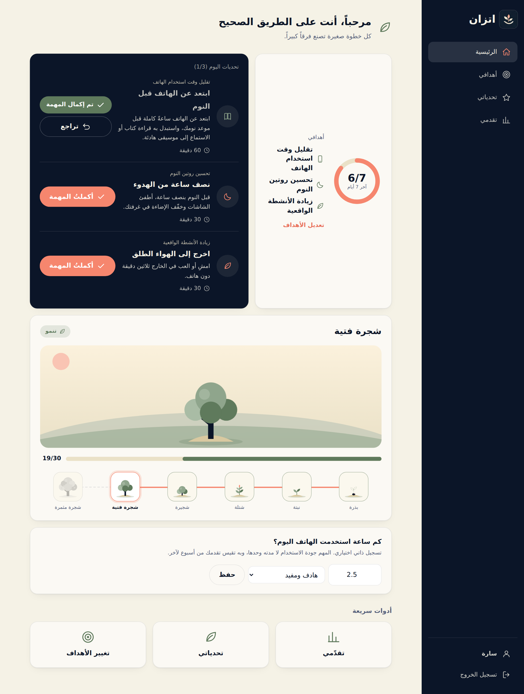
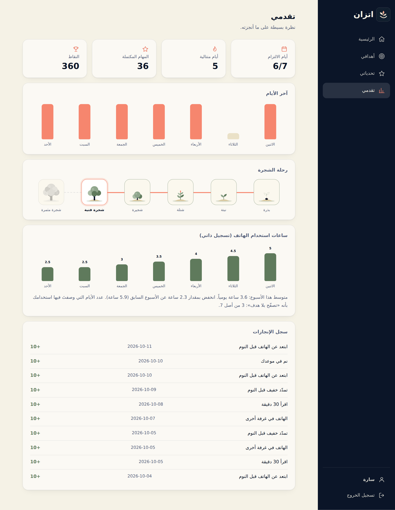
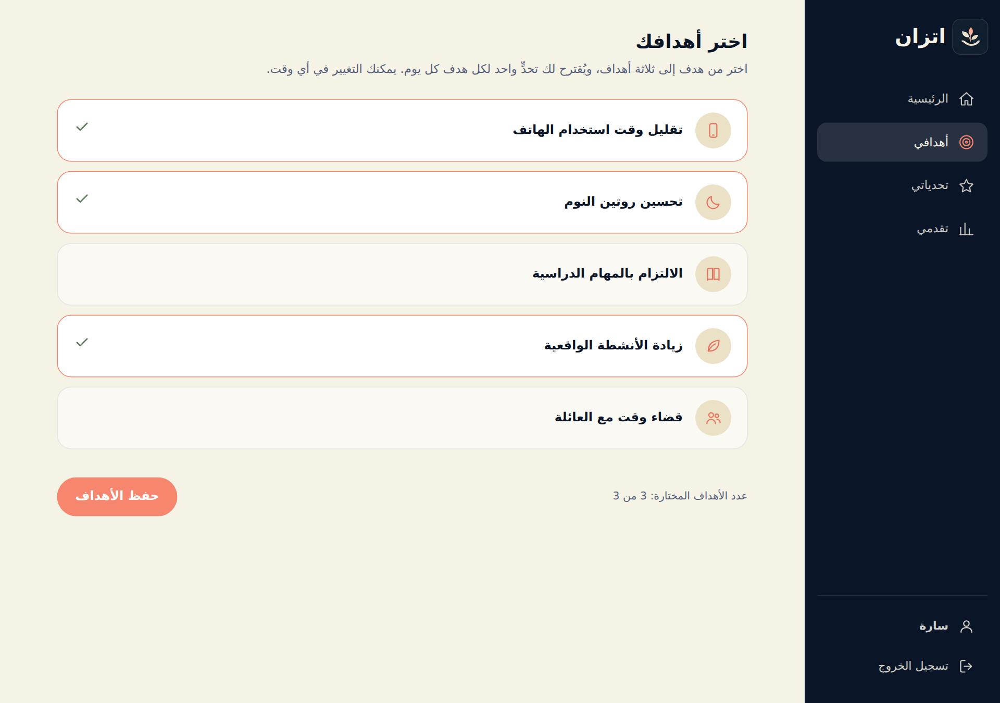
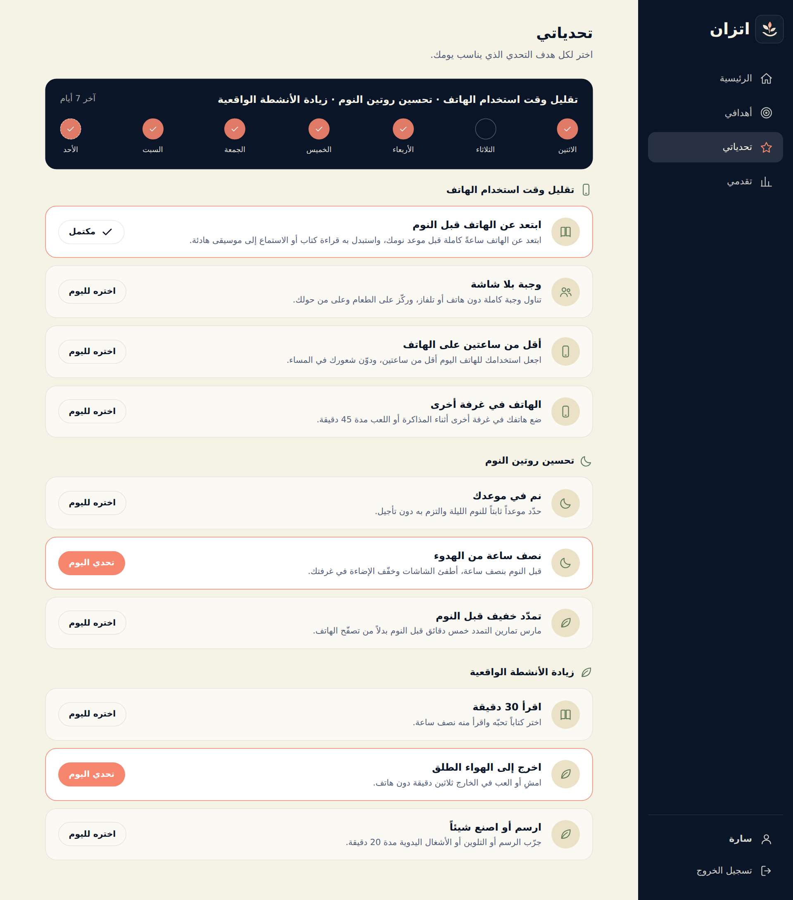
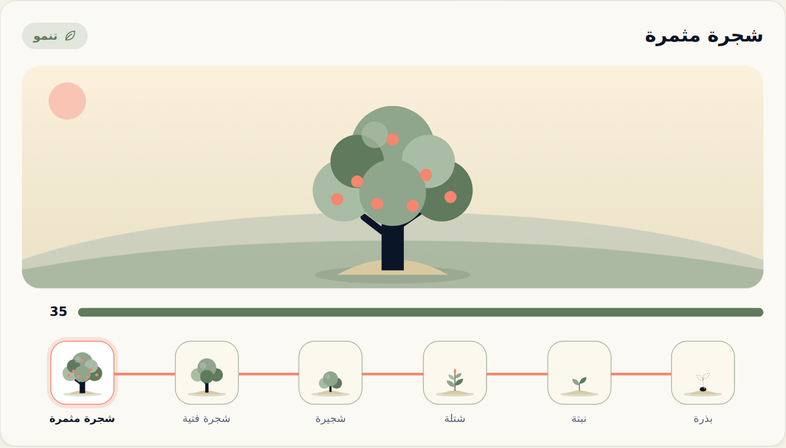
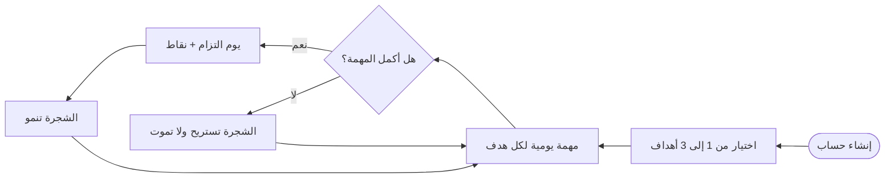
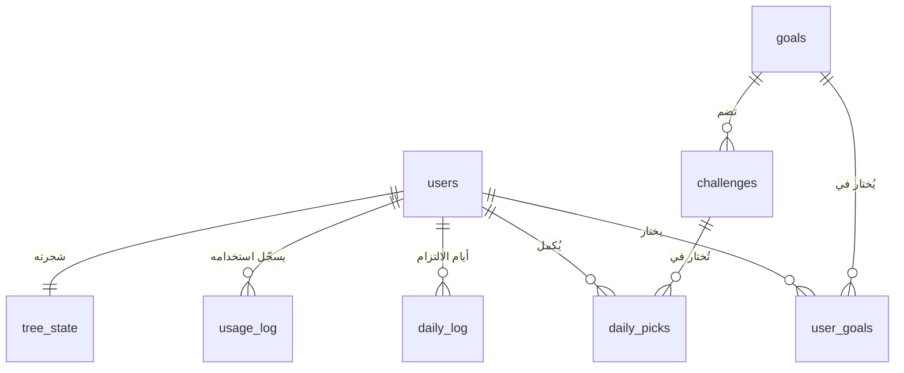

<div align="center">


<br>

[](../../actions/workflows/tests.yml)


### بذرة صغيرة كل يوم… وشجرة تنمو معك 🌱

</div>

<div dir="rtl">

**اتزان (Itizan)** منصة ويب عربية تساعد الأطفال واليافعين على تقليل الاستخدام المفرط للشاشات، لا بالحجب ولا بالمراقبة، بل بـ**بدائل واقعية صغيرة**: تختار هدفاً، فتصلك مهمة بسيطة كل يوم تستبدل بها وقتاً أمام الشاشة بشيء حقيقي، وكلما أكملتها نمت **شجرتك الافتراضية** من بذرة إلى شجرة مثمرة.

وُلدت الفكرة استجابةً لتحدّي **«الإدمان الرقمي»** في جائزة نورة الملاحي للابتكار الاجتماعي التقني.

---

## الفهرس

[الفكرة](#الفكرة) · [لمحة عن المشروع](#لمحة-عن-المشروع) · [الشجرة](#الشجرة-الافتراضية) · [مبادئ التصميم](#مبادئ-التصميم) · [جرّبه](#جرّبه-في-دقيقتين) · [كيف يعمل](#كيف-يعمل) · [الأمان والخصوصية](#الأمان-والخصوصية) · [الاختبارات](#الاختبارات) · [خارطة الطريق](#خارطة-الطريق)

---

## الفكرة

الاستخدام المفرط أو القهري للتقنية يُفقد صاحبه السيطرة على مدة الاستخدام وتكراره، ويؤثر في دراسته وعلاقاته وصحته، وأكثر من يتأثر به الأطفال واليافعون. وأدوات كثيرة تكتفي بقياس الوقت أو منعه، والطفل الذي يُطلب منه ترك الشاشة دون بديل جذاب يعود إليها.

لذلك يقوم اتزان على أمرين:

| | |
|---|---|
| **بديل واقعي كل يوم** | مهمة صغيرة يمكن البدء بها فوراً: وجبة بلا شاشة، نصف ساعة قراءة، تمدّد قبل النوم، حديث مع الأسرة. |
| **قياس الجودة لا الوقت وحده** | يسجّل المستخدم ساعات استخدامه، ويصف استخدامه بأنه *هادف ومفيد* أو *متوازن* أو *تصفّح بلا هدف*. |

---

## لمحة عن المشروع

<div align="center">



</div>

<br>

<table>
<tr>
<td width="50%"></td>
<td width="50%"></td>
</tr>
<tr>
<td align="center"><sub>لوحة التحكم: مهمة لكل هدف، وشجرتك، وتسجيل الاستخدام</sub></td>
<td align="center"><sub>التقدم: أيام الالتزام، رحلة الشجرة، وساعات الاستخدام أسبوعاً بأسبوع</sub></td>
</tr>
<tr>
<td width="50%"></td>
<td width="50%"></td>
</tr>
<tr>
<td align="center"><sub>من هدف إلى ثلاثة أهداف</sub></td>
<td align="center"><sub>تحديات كل هدف، واختيار مهمة اليوم</sub></td>
</tr>
</table>

<div align="center">


<sub>الواجهة متجاوبة: على الجوال تتحول القائمة الجانبية إلى زر ثابت</sub>

</div>

---

## الشجرة الافتراضية

تنمو الشجرة بعدد **أيام الالتزام**، واليوم يُحتسب التزاماً بمجرد إكمال مهمة واحدة على الأقل. فلا تدفع كثرةُ المهام إلى الإفراط.

<div align="center">



</div>

| المرحلة | أيام الالتزام اللازمة |
|---|:---:|
| بذرة | 0 |
| نبتة | 1 |
| شتلة | 3 |
| شجيرة | 7 |
| شجرة فتية | 14 |
| شجرة مثمرة | 30 |

**الشجرة لا تموت.** إن انقطع المستخدم أياماً «تستريح» فقط، فيتحول مشهدها إلى ليل بقمر هادئ، وإن تراجع عن إكمال مهمة فلا تفقد أعلى مرحلة بلغتها (تُحفظ في الجدول `tree_state`). لا عقوبة، ولا خوف من الخسارة.

حدود المراحل معرّفة في `TREE_STAGES` بأعلى قسم الشجرة في `app.py`.

---

## مبادئ التصميم

| المبدأ | كيف يظهر في المشروع |
|---|---|
| **بدائل لا حجب** | كل هدف له مهام واقعية خارج الشاشة، لا قفل ولا مراقبة. |
| **تصميم لا يستهلك الانتباه** | لا إشعارات، ولا محتوى متجدد بلا نهاية. مهمة واحدة لكل هدف يومياً، وثلاثة أهداف حدّاً أقصى. |
| **لا عقاب** | الشجرة لا تموت ولا تتراجع. |
| **أقل قدر من البيانات** | اسم، واسم مستخدم، وكلمة مرور فقط. لا بريد ولا هاتف ولا موقع. |
| **قياس ذاتي لا تتبّع آلي** | كل ما يُسجَّل هو ما يدخله المستخدم بنفسه. |
| **حذف كامل** | يستطيع المستخدم حذف حسابه وكل بياناته في أي وقت. |
| **عربية أولاً** | واجهة RTL كاملة بلغة فصيحة مبسّطة، وخط Cairo، وأيقونات SVG بخطوط رفيعة بلا إيموجي. |

---

## جرّبه في دقيقتين

المتطلبات: **Python 3.10 فأحدث**.

```bash
git clone https://github.com/<اسم-المستخدم>/itizan.git
cd itizan

python -m venv .venv
source .venv/bin/activate        # ويندوز: .venv\Scripts\Activate.ps1

pip install -r requirements.txt
python app.py
```

ثم افتح **http://127.0.0.1:5000** وأنشئ حساباً.

> قاعدة البيانات `instance/itizan.db` ومفتاح الجلسات `instance/secret_key` يُنشآن تلقائياً عند أول تشغيل، ولا يُرفعان إلى Git.

<details>
<summary><b>التشغيل في Visual Studio Code (خطوة بخطوة)</b></summary>

<br>

1. ثبّت Python وVS Code وإضافة **Python** من Microsoft.
2. **File ← Open Folder** واختر مجلد المشروع.
3. افتح الطرفية (`` Ctrl+` ``) وأنشئ البيئة الافتراضية ونفّذ `pip install -r requirements.txt` كما في الأعلى.
   - في ويندوز إن ظهر خطأ «running scripts is disabled» نفّذ: `Set-ExecutionPolicy -Scope Process -ExecutionPolicy Bypass`
4. اضغط `Ctrl+Shift+P` ← **Python: Select Interpreter** واختر مفسّر `.venv`.
5. اضغط **F5** واختر **تشغيل اتزان (Flask)**، أو نفّذ `python app.py`.

لعرض الجداول: ثبّت إضافة **SQLite Viewer** وافتح `instance/itizan.db`. ولتصفير كل شيء احذف مجلد `instance/` وأعد التشغيل.

</details>

---

## كيف يعمل

### رحلة المستخدم



### البنية

| الطبقة | التقنية |
|---|---|
| الخلفية | Python وFlask |
| قاعدة البيانات | SQLite (بلا خدمات خارجية) |
| الواجهة | HTML وCSS وJavaScript دون مكتبات، وقوالب Jinja2 |
| الاختبارات | `unittest` |

```
itizan/
├── app.py                  الخادم، قاعدة البيانات، الـ API، منطق الشجرة
├── requirements.txt
├── templates/              base · landing · auth · app
├── static/
│   ├── css/style.css
│   ├── js/                 app.js · auth.js · landing.js
│   └── img/                الشعار والأيقونات
├── tests/test_app.py       اختبارات الحسابات والأهداف والشجرة والترحيل
├── scripts/impact_report.py   مؤشرات مجمّعة بلا بيانات شخصية
├── docs/images/            صور هذا الملف
└── .github/workflows/      تشغيل الاختبارات تلقائياً
```

### قاعدة البيانات



- `daily_picks`: مهمة كل هدف في كل يوم (واحدة لكل هدف).
- `daily_log`: سجل مجمَّع لأيام الالتزام، وعليه تقوم الشجرة والأيام المتتالية.
- عند التشغيل تُرحَّل تلقائياً بيانات النسخ السابقة (هدف واحد وإنجازاته) إلى الصيغة الحالية دون فقدان، ولا يتكرر الترحيل.

<details>
<summary><b>مسارات الـ API</b></summary>

<br>

كلها (عدا التسجيل والدخول) تتطلب جلسة مسجّلة، وكل طلب مغيِّر للبيانات يحمل الترويسة `X-Requested-With: itizan`.

| الطريقة | المسار | الوظيفة |
|---|---|---|
| POST | `/api/register` | إنشاء حساب وتسجيل الدخول |
| POST | `/api/login` | تسجيل الدخول |
| POST | `/api/logout` | تسجيل الخروج |
| GET | `/api/me` | بيانات الحساب |
| POST | `/api/account/delete` | حذف الحساب وبياناته (يتطلب كلمة المرور) |
| GET | `/api/goals` | الأهداف المتاحة والمختار منها والحد الأقصى |
| POST | `/api/goals` | حفظ الأهداف `{"goal_keys": ["sleep", "study"]}` |
| GET | `/api/today` | مهمة اليوم لكل هدف وحالتها |
| POST | `/api/today/complete` | إكمال مهمة هدف `{"goal_key": "sleep"}` |
| POST | `/api/today/undo` | التراجع عن إكمال مهمة (أو كل مهام اليوم) |
| GET | `/api/challenges` | تحديات كل هدف في مجموعات |
| POST | `/api/challenges/<id>/select` | جعل التحدي مهمة اليوم لهدفه |
| GET | `/api/tree` | حالة الشجرة ومراحلها |
| POST | `/api/usage` | ساعات الاستخدام وجودته `{"hours": 3, "quality": "balanced"}` |
| GET | `/api/progress` | الإحصائيات وسجل الإنجازات وملخص الاستخدام |

</details>

---

## الأمان والخصوصية

- كلمات المرور تُحفظ مجزّأة بخوارزمية **PBKDF2-SHA256**، ولا تُحفظ نصاً.
- جلسات موقّعة بملفات ارتباط `HttpOnly` و`SameSite=Lax`، ومفتاح التوقيع يُولَّد محلياً.
- حماية من تزوير الطلبات (CSRF) بترويسة مخصصة، وتحديد لمحاولات الدخول الخاطئة.
- ترويسات أمنية وسياسة محتوى (CSP) تمنع السكربتات المضمّنة.
- بيانات كل مستخدم معزولة عن غيره، وتُحذف بالكامل مع الحساب (`ON DELETE CASCADE`).

**قبل النشر العام:** شغّله خلف HTTPS وعيّن `ITIZAN_HTTPS=1` و`ITIZAN_SECRET_KEY`، ولا تستخدم `debug=True`، وانقل تحديد المحاولات من الذاكرة إلى مخزن مشترك إن شغّلت أكثر من عملية.

---

## الاختبارات

```bash
python -m unittest discover tests -v
```

تغطي الاختبارات الحسابات وتشفير كلمات المرور وتحديد المحاولات وعزل البيانات وحذف الحساب، والأهداف المتعددة وحدودها، ومنطق الشجرة (النمو، وعدم التراجع، والاستراحة)، وترحيل قاعدة بيانات قديمة دون فقدان. وتعمل تلقائياً على GitHub عند كل دفعة.

### مؤشرات الأثر

```bash
python scripts/impact_report.py
```

يطبع أرقاماً **مجمّعة** فقط (عدد الحسابات، ونسبة إكمال المهام، وتغيّر متوسط ساعات الاستخدام، وتوزيع جودته) دون أي اسم أو بيانات شخصية.

---

## خارطة الطريق

هذا **نموذج أولي يعمل**، لم يُنشر للعموم ولم يُختبر ميدانياً بعد. وما بعده:

- [ ] تجربة ميدانية صغيرة مع أطفال ويافعين وأسرهم لقياس الأثر
- [ ] استعادة كلمة المرور (دون جمع بريد) أو ربط الحساب بولي الأمر
- [ ] عرض خاص بولي الأمر بموافقة المستخدم
- [ ] مراجعة المهام من مختصين تربويين ونفسيين وتوسيع مكتبتها
- [ ] اختبار الإتاحة مع قارئات الشاشة
- [ ] تطبيق ويب تقدّمي (PWA) للجوال
- [ ] الانتقال إلى PostgreSQL عند التوسع

---

## شفافية

- طُوّرت الشيفرة والتوثيق بمساعدة أدوات ذكاء اصطناعي، أما الفكرة والمتطلبات وقرارات التصميم فمن صاحبة المشروع.
- **التطبيق نفسه لا يستخدم أي ذكاء اصطناعي ولا يتتبع المستخدم خفية.**
- الصور في هذا الملف لقطات حقيقية للتطبيق ببيانات تجريبية.

## الترخيص

لم يُحدَّد ترخيص بعد، فجميع الحقوق محفوظة لصاحبة المشروع إلى حين إضافة ملف `LICENSE`.

---

<div align="center">

**اتزان** · علاقتك بالتقنية، باجتهادك

صُنع بعناية من **شهد المالكي**

</div>

</div>
